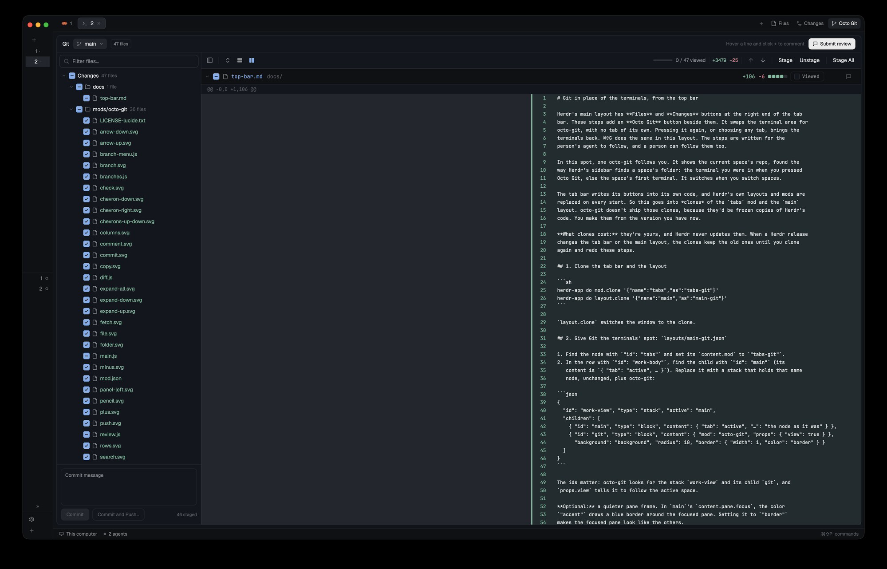

# Octo Git for Herdr

A Git view for the [Herdr](https://herdr.dev) desktop app, in the spirit of
JetBrains' commit view and a GitHub pull-request review. On the left, every changed
file in a tree with a checkbox to stage it, and a commit box. On the right, every
change in one long diff, where you leave review comments for a coding agent. Above
both, the branch: a JetBrains-style menu to switch, create, update, merge, rebase and
push.



Written from scratch as a native Herdr mod (no web view).

## What it does

- **Change tree.** Every changed file, in folders that fold into one row when a folder
  holds only one folder (`apps/shop`). The checkbox stages: a file's box stages or
  unstages it, a folder's box does every file under it, and a partly staged one shows
  a dash. Names are colored by status: modified, added, deleted, conflicted. A filter
  box narrows the tree.
- **Commit.** A message box with **Commit** and **Commit and Push…**. The second
  commits, then opens the push dialog.
- **All the changes in one diff.** Every changed file in one scrolling list, side by
  side or unified, each under a header with its stage checkbox, `+N −N`, a five-block
  change bar, and a button that copies its path. Above it, a toolbar to hide the file
  panel, fold or unfold every file, switch between split and unified, jump to the
  previous or next change, and stage, unstage or stage everything.
- **Viewed.** As on GitHub: tick a file's **Viewed** box to fold it, and the toolbar
  counts **N / M viewed**. A file that changes again counts as not viewed. Remembered
  per repo.
- **More context.** The rows between changes expand like GitHub's: ↑ and ↓ show 20
  more lines at a time, and ↕ shows a short gap whole.
- **Review comments for an agent.** Hover a line and click its **+** to comment under
  it, or comment on a whole file from its header. **Submit review** sends every
  comment, plus an optional note, as one message to a coding agent: one already
  running in the space, or a new one in its own tab. With no comments, the agent
  reviews the changes itself.
- **The branch menu.** Click the branch in the header:
  - search across branches and actions, and Fetch;
  - **Update Project** (asks whether to merge or rebase when both sides have commits,
    and can remember the answer), Commit, Push, New Branch, Checkout Tag or Revision;
  - **Recent**, **Local**, **Remote** and **Tags**, with names containing `/` grouped
    into folders, and ↓/↑ for commits to pull and to push;
  - per branch: checkout, new branch from it, checkout and rebase, checkout and update,
    rebase, merge, new worktree (opened in a new tab), update, push, rename, delete.
- **Push dialog.** As in JetBrains: where the branch goes (with **New** when it isn't on
  the remote yet), the commits going with it, and for the selected one its files and
  message. Push tags (all, or the current branch's), and Force Push under the ▾ (the
  safe kind, which refuses if someone else pushed).
- **Careful with your work.** A checkout that would overwrite your uncommitted changes
  doesn't happen, and says which files are in the way. Update, merge and rebase put
  your changes aside and bring them back. When a merge or rebase stops on conflicts, a
  bar under the header says so, with **Abort** and **Continue**.
- **Live.** It reloads when files or refs change, from any terminal.

Deleting an unmerged branch, a remote branch or a tag, resetting to the remote branch,
and force pushing ask first, and say what is lost. When git refuses something, its own
message shows.

## What it runs

The mod runs `git` in the repository (on its machine, for spaces on another machine)
and reads files there to show new files whole and to expand context. Reads never write
under `.git`. Git reaches the network only for Fetch (the button, and a quiet fetch
each time the branch menu opens), Update, Push, and deleting a remote branch or tag.
Writes run with git's login prompts and editors switched off, so nothing waits for an
answer. Every git call is an argument list; the mod never runs a shell, and names
you type can't start with `-`.

Submit review hands the message to Herdr: `hc send` to a running agent, or a new tab
with the agent you pick. The mod makes no network requests of its own.

## Install

Ask your Herdr agent: *"add the mod at github.com/eduarddotgg/herdr-mods"*. It
reads [RECIPE.md](RECIPE.md) and the files, copies `mods/octo-git/` into
`~/.config/herdr-app/mods/`, and checks it.

Or by hand:

```sh
git clone https://github.com/eduarddotgg/herdr-mods
cp -R herdr-mods/mods/octo-git ~/.config/herdr-app/mods/
```

Then add the key from [keys.json](keys.json) to the `global` section of your
`~/.config/herdr-app/keys.json`:

```json
"cmd-shift-g": "mod.open:octo-git"
```

⌘⇧G opens the space's Octo Git tab, or brings it back.

If you already have a mod called `octo-git`, rename this one's folder, and the
`mods/octo-git/` paths and `mod: "octo-git"` names inside it, to match.

### The Octo Git layout (optional)

The `octo-git` layout is Herdr's own layout with an **Octo Git** button at the right
end of the tab bar, after Files and Changes. The button swaps the terminal area for
Octo Git, with no tab of its own. Pressing it again, or choosing any tab, brings the
terminals back, and ⌘⇧G does the same. This Octo Git follows you: it shows the
current space's repo, taken from the terminal you were in, else the space's first
terminal, and it switches when you switch spaces.

```sh
cp herdr-mods/layouts/octo-git.json herdr-mods/layouts/octo-git.svg ~/.config/herdr-app/layouts/
herdr-app do layout.switch --name octo-git
```

Or pick **octo-git** in Settings, or cycle layouts with `ctrl-shift-l`. The tab bar,
sidebar, status bar, Files and Changes are Herdr's own mods, so they keep getting
Herdr's updates. Only the layout file, Herdr 0.1.12's `main` with the button and the
swap added, stays as it is. In other layouts, ⌘⇧G opens the Octo Git tab as
usual.

## Limits

- Tested on macOS with Herdr 0.1.12. Linux and Windows aren't tested yet. There,
  the layout's Octo Git button sits after the window buttons, because Herdr's tab
  bar draws those at its end.
- The layout is a snapshot of Herdr 0.1.12's `main`. If a later Herdr changes `main`,
  the layout keeps the old arrangement until this file is updated.
- Herdr stops a command after 30 seconds, so a fetch, update or push over a slow
  network can fail there.
- Up to 1,000 changed files and 1,500 diff lines per file. Up to 200 new files are
  read whole (their first 400,000 characters); binary and unreadable ones show a note
  instead.
- No syntax highlighting, and the diff's text can't be selected.
- Not in this version: a smart checkout that puts your changes aside and switches
  anyway, and a conflict resolver (for now, fix the conflict markers in an editor and
  press Continue).

## Development

The repo is the one place to edit. `npm run dev` copies `mods/octo-git` into
`~/.config/herdr-app/mods/` and `layouts/` into `~/.config/herdr-app/layouts/`, and
again on every save, and Herdr reloads them. Herdr
doesn't notice edits through a symlink, so the copy is how it stays live. Don't edit
the copy: the next save overwrites it.

```sh
npm run dev             # copy now, then after every change (Ctrl-C to stop)
npm run install-local   # copy once
npm test
```

The tests check the pure parts with `node:test`: the change tree, diff rows, context
expanders, the review message, the branch menu's parsing and decisions, and the
ids the layout must keep for the mod and Herdr's tab bar. The UI
was checked by hand in Herdr, on a demo repository with a bare "remote".

## Contributing

Pull requests are welcome.

- Run `npm test` and say in the PR that it passes.
- **If the change shows on screen, add a screenshot**, before and after when it fixes
  something you can see.
- Say which Herdr version and OS you tested on.
- Update `RECIPE.md` when behavior changes, so the recipe still builds what the mod
  does.

## License

Most icons are drawn after [Lucide](https://lucide.dev) (ISC, see
`mods/octo-git/LICENSE-lucide.txt`).
