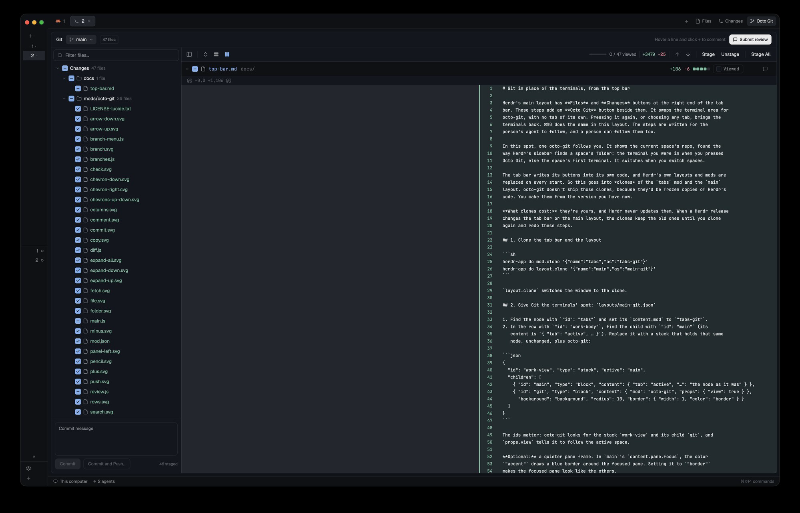

# Octo Git

An "Octo Git" tab for committing and reviewing a repo. On the left is a commit view: every changed file in a folder tree, each with a checkbox to its left that stages or unstages it, plus a commit message box. On the right, every changed file's diff sits in one long panel, like a pull-request review: side by side (old on the left, new on the right) or unified in one column, with a toolbar to fold every file, step from change to change and stage.

Hover a line and click its `+` to leave a plain-text comment under it, in the half of the diff it belongs to, as on GitHub. "Submit review" opens a small "Finish your review" popover that sends every comment, plus an optional note, as one message to a coding agent: one already running in the space, or a new one in its own tab. It works with no comments too, and then the agent reviews the changes itself. `cmd-shift-g` opens the space's Octo Git tab, or brings it back. The tab stays as you left it when you switch away.



## What you see

The mod fills its tab's pane (the whole work area beside Herdr's sidebar), drawn in the theme's colors: `background` behind it all, `border` for every line, UI font at 13px. Herdr's own pane header (showing "octo-git") sits above it in the shipped layout.

1. **Header bar (42px, full width, border below).**
   - On the left: "Git" in semibold, then a 14px branch icon and the current branch in `muted`, then a pill (`border` outline, 4px radius, 11px `muted` text) reading "N files".
   - On the right:
     - While there are changes but no comments, "Hover a line and click + to comment" in 12px `dim`.
     - The **Submit review** button, always active: 28px tall, radius 7, 12px text, `solid`/`solid_foreground`, with a 13px comment icon. With comments it adds a count pill (11px, `foreground` on `background`, radius 8).
2. **Commit view (left column).** It starts 360px wide. Drag the divider on its right (a 1px `border` line) to make it anywhere from 240 to 720px wide.
   - **Filter box (32px, 6px from the column's edges).** A 1px `input` frame (`accent` while it has the keyboard) on `background`, radius 8, 10px side padding. It holds a 14px search icon in `dim`, then the text field (13px), placeholder "Filter files…". While it has text, a 20px × (12px `muted` icon, `hover` background) sits on its right. Clicking anywhere in the frame puts the keyboard in the field.
   - **Change tree.** It scrolls under the filter box, with 6px padding. Rows are 28px high, rounded 6px, and indented 18px per level.
     - **Root row:** a chevron, a checkbox, then "Changes" in semibold and "N files" in 12px `dim`.
     - **Folder rows:** a 12px chevron (down when open, right when folded) in `dim`, a 16px checkbox, a 14px folder icon in `muted`, the name, and "N files" in 12px `dim`.
     - **Folded chains:** a folder whose only content is one folder merges into it, so it shows as `apps/shop` or `.maestro/flows`. Folders come before files, both alphabetical, and all start open.
     - **File rows:** these sit one chevron-width (18px) further in, with a checkbox, a 14px file icon, and the name colored by status. Modified is `ansi4`, added or untracked `ansi2`, deleted `ansi1`, and conflicted `ansi3`. No line counts: those are in the diff's headers.
     - **Selected file:** the row you last clicked has a `selected` background.
     - **Hover:** any row shows `hover` on hover.
   - **Checkbox.** A 16px square with a 4px radius and a 1px border, which is `input` when empty.
     - When checked or partial, the box fills with `accent` and shows an 11px check (fully staged) or minus (partly staged) in `accent_foreground`.
     - A folder's box is checked when every file under it is fully staged, empty when none of them has anything staged, and minus otherwise.
   - **Commit box.** It sits at the bottom with 10px padding, below a draggable divider. It starts 150px tall, and you can drag it from 110 to 480px.
     - A message textarea in a 1px `border` frame (radius 8, `accent` while typing) fills the box's height above the button row. Its placeholder is "Commit message".
     - Below it, "N staged" in 11px `dim` on the left and a 30px Commit button on the right. The button is `solid`/`solid_foreground` when it can commit and `raised`/`dim` otherwise. It reads "Working…" while a git command runs.
     - Below that, any error in 11px `ansi1`, or after a commit, git's first output line (`[main 1a2b3c4] message`) in `dim`.
3. **Diff toolbar (40px, across the diff's width, border below, UI font).** 8px side padding. Icon buttons are 28px squares (radius 6) with 16px icons: `muted` when they can act, `dim` when they can't, and `hover` behind them on hover. Text buttons are 28px tall with 8px side padding, 13px text in `foreground` when they can act and `dim` when they can't. Dividers are 1px × 18px `border` lines with 6px on each side. Every button has a tooltip.
   - On the left: show/hide the file panel (`panel-left`; "Hide files" or "Show files"), a divider, fold all (`chevrons-up-down`; "Collapse all files" while any file is open, else "Expand all files"), unified view (`rows`) and split view (`columns`). The view in use has an `accent` icon.
   - On the right: the total `+adds` in `ansi2` and `−dels` in `ansi1` (12px, with thousands separators), a divider, ↑ "Previous change" and ↓ "Next change", a divider, Stage and Unstage (tooltips "Stage Cart.tsx", naming the file they act on), a divider, and Stage All ("Stage every changed file").
4. **All-in-diff (the rest of the width).** It's in the terminal font (`settings().font_family`, else JetBrains Mono) at 12px, with a scrollbar overlaid on the right. Files appear in the same order as the tree. Each file is:
   - **Header (40px, 13px text).**
     - `chrome` background with a border above and below, 10px of left padding, 24px of right padding and 8px gaps.
     - In order: a 12px chevron, a 16px checkbox, a 14px file icon, the file name in `accent` (`ansi1` if deleted), and its folder path with a trailing `/` in `dim` (none for a file at the repo root).
     - **The copy button:** while the pointer is over the name or the path, a 22px button (radius 5, `hover` behind it on hover) with a 13px `muted` copy icon appears 10px after the path. A 22px slot is kept for it, so a long path truncates before it. After a click it shows an `ansi2` check for 1.5 seconds.
     - On the right: `+N`/`−N`, then a change bar of five 8px blocks (radius 2, 2px apart): the share of added lines in `ansi2`, then removed in `ansi1`, each rounded down, and the rest `input` (`+7 −2` is three green, one red, one neutral). Then, 8px further on, the file's comment count in 11px `accent` (when it has any) and a 14px comment icon. The icon is `accent` when the file has comments, `dim` otherwise.
   - **Hunk rows (24px).** The `@@ -a,b +c,d @@ context` line in `dim` on `surface`. Where unchanged lines are hidden before a hunk, the row becomes an expander (below). A file whose diff starts at its first line keeps the plain row.
   - **Expander rows (24px, `surface`, `hover` on hover).** A cell as wide as the line-number gutter (65px split, 105px unified), tinted `accent` at alpha `22`, holds a 16px `accent` icon. The rest of the row shows the hunk's `@@` line in `dim`, on the expander just above the hunk. The icons:
     - `expand-up` (an arrow up over a dotted line): above the first change, or above a hunk when more than 20 lines are hidden.
     - `expand-down` (a dotted line over an arrow down): under a hunk when more than 20 lines are hidden, and after the last change.
     - `expand-all` (arrows up and down around a dotted line): between two hunks when 20 lines or fewer are hidden.
     - Between two hunks with more than 20 hidden lines, there are two rows: ↓ first (no text), then ↑ with the `@@` line.
   - **Shown unchanged lines** look like context lines, numbered on both sides.
   - **Line rows (20px).** Two equal halves split by a 1px `border` line. Each half is a 3px change bar, a 40px right-aligned line number (6px right padding), a 22px slot for the `+`, then the text, which is truncated rather than wrapped (tabs become 4 spaces).
     - A removed line is on the left, tinted `ansi1` at alpha `2a`, with an `ansi1` bar and number.
     - An added line is on the right, tinted `ansi2` at `2a`, with an `ansi2` bar and number.
     - Context lines appear on both sides with `dim` numbers.
     - Where one side has no line, that half is a blank `raised` block.
     - The line the comment box is open for has a `selected` background on its half.
     - **The `+`:** while the pointer is over a half that can take a comment (a removed line on the left, any line on the right), a 17px `accent` square (radius 4) with an 11px `accent_foreground` plus appears in the `+` slot. The line the comment box is open for shows none.
     - **Unified view:** one full-width column per diff line, in git's order (a change's removed lines, then its added ones). Each row is the 3px bar, two 40px numbers (old, then new; a removed line has only the old one, an added line only the new one), the 22px `+` slot, then the text. Removed and added lines are tinted and colored as in the halves above. Every line can take a comment.
   - **Comment cards.**
     - **Where they go:** each comment sits right under its line, in that line's half, from where the code starts (65px into the half) to 12px before the half's edge. The other half stays empty, and the center divider runs through. In the unified view a card spans the column from where the code starts (105px) to 12px before the edge. Whole-file comments, and comments whose line is no longer in the diff, sit under the file header across the full width (12px margins).
     - **Tone:** a comment on an added line is `ansi2`, on a removed line `ansi1`, and on a context line or a whole file `accent`.
     - **Head row (30px, 6px above):** tone background at alpha `1a`, a 1px border in the tone at alpha `88`, top corners radius 8, 12px left padding and 6px right. It holds a 12px comment icon and the anchor in 11px tone: `R8` (new line 8), `L3` (old line 3), "Whole file", or `R8 · no longer in the diff` followed by that line's code in `dim`. On the right are two 24px icon buttons, 2px apart (`hover` background, 13px `muted` icons): a pencil (edit) and a bin (delete).
     - **Body (6px below):** `surface`, the same tone border, bottom corners radius 8, 12px × 8px padding. The comment is wrapped to the card's width, one 18px line per row in `foreground`.
   - **The comment box** sits where a new comment will go (or in place of the card being edited), in the same half and width as a card, framed by a 1px `accent` border on `surface` with radius 8:
     - A 34px title row: a 13px `accent` comment icon and, in semibold, "Add a comment on line R19", "Edit comment on line R19" or "Add a comment on the whole file".
     - A 112px row holding the textarea in a 1px `input` frame on `background` (radius 6), placeholder "Leave a comment".
     - A 46px row: "Plain text, sent to the agent as written" in 11px `dim`, then Cancel (72px wide, bordered) and Comment (84px wide; "Update" when editing), 8px apart and 12px from the right. Comment is `solid` once there's text, `raised`/`dim` before. Both are 28px tall with radius 7 and 12px text.
   - **Notice rows (28px, `dim`).** These replace a diff: "Binary file", "No text changes", "Cannot preview this file (binary, too large or unreadable)", "The diff is too large to show". After a long file you'll see "Showing the first 1,500 lines".
   - **A 6px gap** before the next file.
5. **The "Finish your review" popover.** It hangs under the Submit review button, with its top right corner at the button's bottom right. It's 460px wide on `popover`, with a 1px `border`, radius 10, a large shadow, 14px padding and 10px gaps:
   - "Finish your review" in semibold, with a 24px × on the right.
   - A summary in 12px `muted`: "3 comments on 1 file go with it." or "No comments: the agent reviews all uncommitted changes itself."
   - A note textarea in a 96px `input` frame on `background` (radius 8), placeholder "Leave a note for the agent (optional)".
   - "Send to" in 11px `dim`, then a list of choices (it scrolls past 230px). Each is a 32px row (radius 7):
     - A 14px radio circle. The chosen one has an `accent` ring and a 6px `accent` dot, the others an `input` ring.
     - The 14px program icon.
     - The label: "Claude Code · tab 1" for each agent running in the space, with a 7px dot in its status color, then "New Claude Code" (and every other installed agent) with "new tab" in 11px `dim`.
     - The chosen row has a `selected` background, and the others show `hover` on hover.
     - A `blocked` agent is `dim`, reads "needs an answer first", and can't be chosen.
   - Any error in 11px `ansi1`, then a bottom row: "Sending…" in `dim` while it goes, Cancel (bordered) and Submit review (`solid`; `raised`/`dim` while sending or with nothing to choose).
6. **Empty states.** The tree shows "Loading changes…", "Not a git repository", "No folder" or "No uncommitted changes" in `dim`.

## How it behaves

- **Opening.** `cmd-shift-g` (`mod.open:octo-git`) selects the active space's Octo Git tab, or opens one named "Octo Git" if the space has none. A new tab takes its repo from the focused pane's live folder (on that pane's machine). Each space has one Octo Git tab, which stays on the repo it was made for until you close it with the tab's ×. Switching to another tab and back finds it exactly as it was: scroll, folds, comment box and all.
- **In the octo-git layout** there's no tab. An Octo Git button after Files and Changes, and `cmd-shift-g`, swap the terminal area for Octo Git and back. Choosing any tab, or `+`, brings the terminals back. It shows the current space's repo (the focused terminal's folder, else the space's first terminal's), and switches when you switch spaces.
- **Agent states** appear only in the popover. Each running agent's dot is `working`, `blocked`, `done` or `idle` in that theme color.
  - A `blocked` agent can't be chosen.
  - Working, done and idle agents can all be chosen. The review is pasted in whenever the agent next takes input.
- **Checkbox clicks.**
  - A checkbox click anywhere (tree file, tree folder, root row, diff header) stages when the box isn't fully checked, and unstages when it is.
  - A folder or root box acts on every file under it.
  - The boxes flip at once, then the tree and diff reload from git.
  - Partial staging (some hunks staged) shows as a minus box. You can't stage single hunks or lines.
- **Folding.**
  - Clicking a folder row anywhere except its checkbox folds or unfolds it in the tree. Folding a folder (or the root) also folds every folder under it. Unfolding it opens only that folder, so the ones under it stay folded until you open them one by one.
  - Clicking a diff header anywhere except its checkbox, copy button or comment icon folds or unfolds that file's diff.
- **Filtering.** Typing in the filter box keeps only the files whose path contains the text, ignoring case (`ts` keeps `apps/shop/assets/logo.png` too, because `assets` contains it). The tree is rebuilt from those files, with every folder open whatever you had folded. The root row and folders count only the matches, and their checkboxes stage only the matches. Folders you fold while filtering are forgotten when the text changes. Clearing the text (× or deleting it) brings back the full tree with your own folding. With no match, the tree reads "No files match" in `dim`. The diff isn't filtered.
- **Jumping.** Clicking a file row in the tree highlights it, unfolds its diff if it was folded, and scrolls the diff so that file's header is at the top (as high as it goes, for the last files).
- **The toolbar.**
  - **Show/hide files** hides the whole left column (tree, filter and commit box) so the diff takes the full width, and brings it back at the width it had. It's shown whenever the tab opens.
  - **Fold all** folds every file's diff while any is open, and opens them all when none is.
  - **Unified / split** switches the diff's layout. The file at the top stays in view (its header comes to the top). Comments keep their place under their line. The choice lasts until Herdr restarts; it isn't saved.
  - **↑ / ↓** go to the previous or next change: the first line of a run of added or removed lines, across files, in the diff's order. That line comes to the middle of the diff, its file is highlighted in the tree, and a folded file unfolds. Counting starts from the last change gone to while it's on screen, otherwise from the top of the diff. Each arrow is `dim` when there's no change that way.
  - **Stage / Unstage** act on the whole of the current file: the one picked in the tree or reached with the arrows while its header is on screen, otherwise the file at the top of the diff. Stage is `dim` when that file is fully staged, Unstage when nothing of it is.
  - **Stage All** stages every changed file (`dim` when all are staged).
- **Expanding.** Clicking anywhere on an expander row shows the lines it stands for: ↑ the 20 hidden lines just above the code under it, ↓ the 20 just below the code over it, ↕ everything between two hunks. Rows come and go as you expand: once a gap is all shown, its expander and the `@@` row disappear, and the hunks run together. The end of a file shows ↓ while its length isn't known: the last change has 3 lines after it. Once the file has been read, ↓ shows only while lines remain. Expanded lines can take comments like any context line. They stay expanded across reloads and switching views, until the tab closes or the file has no changes left.
- **Copying a path.** The header's copy button puts the file's path relative to the repo (`apps/shop/src/components/Cart.tsx`) on the clipboard.
- **Commenting.**
  - **On a line:** click the `+` (anywhere in that half's gutter: change bar, line number or `+` slot). The comment box opens under the line, in its half, with the keyboard in it. The list scrolls just enough to show the whole box. The left half's `+` (removed lines) comments on `L<n>`, and the right half's (added and context lines) on `R<n>`. Clicking the code itself does nothing.
  - **On a whole file:** click a header's comment icon. The box opens under the header, and a folded file unfolds.
  - **Saving:** Comment turns the box into a card, and the header's count goes up. Cancel closes the box.
  - **One box at a time.** Clicking another `+` moves an empty box there. A box with unsaved text stays put, and the list scrolls back to it. Clicking the gutter of the line the box is already on keeps it and its text.
  - **Editing:** click a card (anywhere but the bin) to turn it into the comment box with its text, then use Update or Cancel.
  - **Deleting:** click the bin on a card's head. It's gone at once.
  - **Persistence:** comments are kept per repo and survive closing the tab and restarting Herdr, until they're sent.
- **Sending.**
  - Submit review always opens the popover, even with no comments. A click outside it, Esc, × or Cancel closes it, and the note you typed stays.
  - The first agent you can pick is chosen, running agents before new ones, until you choose another. Submit review sends one message:
    - For a running agent, the message is pasted into it with `hc send` and Enter, and that agent gets focus (its tab comes forward).
    - For "New <Agent>", a new tab named "Review" opens in that space, in the repo folder, running the agent with the message as its first prompt.
  - Once sent, the comments and the note clear and the popover closes. If sending fails, the error shows and everything stays.
  - The message with comments, with your note (or a default instruction to address each comment) at the top:
    ```
    Code review of the uncommitted changes in /path/to/repo (branch main).

    Address each comment below: change the code where a change is asked for, and answer questions in your reply. Change only what the comments ask for.

    Each comment starts with its file's full path. `<path>:<n>` is line n of the file as it is now; "removed line n of HEAD" is a line these changes deleted (`git show HEAD:<file>` has it).

    ## apps/shop/src/components/Cart.tsx

    - /path/to/repo/apps/shop/src/components/Cart.tsx (whole file)
      Add tests for the coupon logic.

    - /path/to/repo/apps/shop/src/components/Cart.tsx, removed line 8 of HEAD: `const total = items.reduce(sum, 0);`
      Keep this as the subtotal.

    - /path/to/repo/apps/shop/src/components/Cart.tsx:10: `const total = coupon === "SAVE10" ? 1 : 2;`
      Don't hardcode coupon codes.
    ```
    Files follow the diff's order, each under a `## <path relative to the repo>` heading. Within a file, whole-file comments come first, then comments by line number. Every comment carries the absolute path (the repo root from `git rev-parse --show-toplevel` joined with the file's path, on the machine the repo is on), so the agent can open it without guessing.
  - The message without comments, with your note in place of the default middle line:
    ```
    Code review of the uncommitted changes in /path/to/repo (branch main).

    Review these changes yourself: report bugs, risks and anything unclear, most important first. Don't change any code yet.

    See them with `git status` and `git diff HEAD` in that folder.
    ```
- **Commit.** The Commit button commits what's staged (`git commit -m <message>`). It does nothing without a message or with nothing staged. On success the message clears, git's summary line shows under the button, and the committed files leave the tree. If git refuses (a hook, no identity), its error shows in red.
- **Live updates.** While the Octo Git tab is on screen, it reloads whenever anything in the repo changes (including staging from a terminal) and at least every 10 seconds. An Octo Git tab in the background only notes that something changed, and reloads within 2 seconds of being shown again. Folded folders and files stay folded across reloads.
- **Large changes.** Diffs open by default until the panel holds 20,000 rows. Files after that start folded but open on click.

## Built from

- **The mod.** `mods/octo-git/` is one mod, plus an optional layout (below). `mod.json` is:
  ```json
  { "place": "none", "title": "Octo Git", "overlay": { "kind": "popup", "width": 1, "height": 1, "frame": "none" } }
  ```
  `keys.json` adds `"global": { "cmd-shift-g": "mod.open:octo-git" }`.
  - **Why the 1×1 popup:** a key passes only one argument, so it can't open a mod as a tab directly.
  - **What the key does:** it opens this invisible popup. The mod sees `props().overlay`, draws nothing, and does one of two things:
    - If the active space already has an Octo Git tab (a pane in its `tabs` whose `panes()` entry has `mod === "octo-git"`), it runs `tab.select` on it.
    - Otherwise it runs `run("tab.new", { space, name: "Octo Git", mod: "octo-git", props: { folder, on, space } })`.
  - Then it calls `closeOverlay`.
  - **The tab copy:** reads its repo from `props().folder` / `props().on` and its space from `props().space`.
- **The layout.** `layouts/octo-git.json` (with its Settings picture, `layouts/octo-git.svg`, set as the root's `preview`) is Herdr 0.1.12's `main` with two changes. Every other node, and every mod in it, is Herdr's as shipped:
  - The `tabs` block becomes a non-resizable row `tab-row` (42px) holding that same block, then a 94px block `git-button` with `window_drag` and `{ "mod": "octo-git", "props": { "button": true } }`.
  - The `main` block becomes a stack `work-view` (active `main`) holding that same block, then `git`: `{ "mod": "octo-git", "props": { "view": true } }` with `background`, radius 10 and a 1px `border`.
  - The ids matter: the mod looks for the stack `work-view` and its child `git`, and Herdr's tab bar looks for `panel` and `panel-body`. `tests/layout.test.mjs` checks them.
  - **The button copy** draws only a pill like the tab bar's Files and Changes buttons (26px tall, 8px side padding, radius 6, 12px text, a 14px branch icon and "Octo Git"; `selected`/`foreground` while Git shows, else `chrome`/`muted`, `hover` on hover) at the right of a `chrome` strip with the bar's bottom `border` and 10px right padding. Its press stops propagation, so it doesn't drag the window. A click runs the launcher's code.
  - **The launcher** checks for that stack first: if the layout has one, it runs `layout.select` on `work-view`, `git` or back to `main`, instead of opening a tab.
  - **The view copy** takes the active space and `location()` when it starts, and a 250ms timer follows: when it's shown again or the active space changes, it takes that space's repo (reloading only if it differs). When the active tab changes in the same space while Git shows, it selects `main`, because Herdr's tab bar can't. It counts as on screen while `work-view`'s active child is `git`.
  - **Name the flag something other than `button`.** The View already has a `button()` method (the review popover's buttons), so `this.button = true` would make every copy draw the pill.
- **Files.**
  - `main.js` is the View: the launcher, loading, staging, commit, comments and rendering.
  - `tree.js` is pure:
    - `buildTree(files)` returns nested `{name, path, dirs, files, paths, staged}` with folded single-folder chains.
    - `flattenTree(tree, collapsedSet)` returns rows (`d:<path>` / `f:<path>` keys, root path `""`).
    - `dirPaths(node)` returns that folder's path and every folder path under it. Folding adds them all to the collapsed set; unfolding removes only the folder's own.
    - `filterFiles(files, query)` keeps the paths containing the trimmed, lower-cased query, or returns all files for a blank one.
  - The view keeps two collapsed sets: yours, and one for the filtered tree that's emptied whenever the filter text changes. The diff's file order always comes from the unfiltered tree.
  - `diff.js` is pure:
    - `splitDiff(text)` returns a Map from path to `{lines from first @@, binary}`. With `--no-renames` the header names the same path twice, so it splits in the middle, and it JSON-unquotes quoted paths.
    - `sideBySide(lines, max)` returns rows: a run of `-` lines pairs row-for-row with the `+` run after it.
    - `unified(lines, max)` returns the same row shape with one row per diff line: `{left, right: null}` for a removed line, `{left: null, right}` for an added one, both for context. The view's rows, comment anchors and click handling work on either.
    - Each file's diff keeps both: `{ split: {rows, more}, unified: {rows, more} }`, so switching views doesn't reload.
    - `addedLines(text)` turns a new file into one all-`+` hunk.
    - `countLines`, and `fileLines(text)` (lines without the empty one after a final newline).
    - Hunk rows keep their header's numbers: `{kind: "hunk", text, old, oldCount, new, newCount}` (a missing count is 1).
    - `gaps(rows, {total, context: 3, cut})` returns the hidden stretches as new-file ranges: one before each hunk (`at`: its row index) and one after the last (`at: null`), each with `delta`, how far new numbers run ahead of old ones there. A side with no lines (`+0,0`) starts at the line before it. The end gap reaches `total` when the file's length is known. Otherwise, if fewer than 3 context lines follow the last change, the file ends there; if not, the end is `Infinity`. A diff cut at 1,500 rows (`cut`) has no end gap.
    - `withContext(rows, gaps, {revealed, lines, step: 20})` returns the rows to draw. Diff rows keep their `index`. Revealed lines (new-file ranges, text from `lines`) become context rows with a `context` number, old number `n − delta`. Each still-hidden stretch becomes expander rows `{kind: "expand", dir, from, to, text}`. The hunk's header text goes on the gap's last expander, and the plain hunk row stays only when its gap is empty.
  - `review.js` is pure:
    - A comment is `{id, path, side: "R" | "L" | null, line, code, text}`, and `anchorOf(comment)` gives `"R8"` (or null for a whole file).
    - `wrapText(text, cols)` breaks at spaces and hard-splits long words.
    - `reviewPrompt({root, branch, note, comments, order})` builds both messages above. Each comment line starts with `<root>/<path>`, then `:<n>` for a line of the new file, `, removed line <n> of HEAD` for a removed line, or ` (whole file)`; any trailing slash on `root` is dropped first.
  - Icons, as 24px lucide-style strokes with `currentColor`, drawn with `svg()`: `chevron-right`, `chevron-down`, `folder`, `file`, `check`, `minus`, `x`, `branch`, `comment`, `plus`, `pencil`, `trash`, `search`, `chevrons-up-down`, `arrow-up`, `arrow-down`, `copy`, `panel-left`, `expand-up`, `expand-down`, `expand-all` (dots drawn as zero-length round-capped strokes). Plus two filled ones: `rows` (two stacked bars, unified) and `columns` (two side-by-side bars, split).
- **herdr functions.**
  - `spaces()`, `panes()` and `focused()`: the launcher's repo (the focused pane's `cwd`, and the machine from the space, like the shipped `changes` mod), finding an existing Octo Git tab, and whether this tab is on screen (its space is active and that space's active tab holds a `octo-git` pane).
  - `exec`, `readTextFile` and `watchFolder` (local repos only).
  - `theme()` and `settings()`.
  - `props()`, plus `closeOverlay` for the launcher.
  - `shared("octo-git.reviews")` / `setShared` hold the comments as `{ "<machine>:<repo root>": Comment[] }`.
  - `agents()` filtered to the space, and `knownAgents({ on })` (loaded each time the popover opens) filtered to `installed`. Program icons are drawn with `svg()` when `tint`, else `image()`.
  - `hc(["send", address, message])` for a running agent, then `run("agent.focus", { terminal })`. For a new agent, `run("tab.new", { space, folder: root, argv: agent.run, task: message, name: "Review" })`.
- **gpui-base pieces.**
  - `h_resizable("octo-git-split")` with two `resizable_panel()`s, the left one `.size(360).size_range(240, 720)`. Inside the left one, `v_resizable("octo-git-commit-split")` holds the tree panel and a commit panel (`.size(150).size_range(110, 480)`). The window keeps the dragged sizes under those ids.
  - `InputState` + `Input` for the filter, inside the mod's own frame (base inputs are unstyled), with `change`, `focus` and `blur` handlers.
  - `TextareaState` + `Textarea`, each `size_full()` inside a frame with a fixed or flexible height: the commit message, the comment box (drawn inside a virtual-list row; its state is made in `init`) and the note.
  - `Popup.new("octo-git-review-popup", button).anchor("top_right").when(open, (e) => e.content(panel))` for the popover. The mod opens and closes it itself: the button's `on_mouse_down` toggles it, and the panel's `on_mouse_down_out` and `on_key_down` (Esc) close it.
  - `v_virtual_list` with a per-row size array, `VirtualListScrollHandle` (`scroll_to_item(i, "top")` for tree jumps and view switches, `"center"` for ↑/↓, `scroll_to_item(i)` to bring the comment box into view) and `Scrollbar.vertical`.
  - `.tooltip(text)` on the toolbar's buttons.
- **Programs it runs.**
  - `git`, in the repo (on the space's machine for remote spaces):
    - Reads:
      - `rev-parse --show-toplevel`
      - `status --porcelain=v1 -z --no-renames --untracked-files=all`
      - `rev-parse --verify -q HEAD`
      - `branch --show-current`
      - `diff HEAD --numstat -z --no-renames` (with no commits yet, `diff --cached` and `diff`)
      - `diff HEAD --no-color --no-ext-diff --no-textconv --no-renames -U3`, once for all files
    - New files are read with `readTextFile`, and so are changed files the first time you expand one, again on each reload while any of their lines are expanded.
    - Writes:
      - Stage: `git --literal-pathspecs add -A -- <paths>`.
      - Unstage: `git --literal-pathspecs restore --staged -- <paths>`, or `rm --cached -r -q` before the first commit.
      - Commit: `commit -m`.
  - `hc send`, only when you send a review to a running agent.
- **Checkbox state from porcelain XY.**
  - `??` is untracked: empty.
  - A conflict (`U` on either side, `AA`, `DD`): empty.
  - X set and Y blank: checked.
  - X and Y both set: minus.
  - X blank: empty.
- **Network.** None. It reads nothing outside the repo, and review text goes only to the agent you pick.

## Watch out

- **Rows in a virtual list can't have their own handlers** (`on_click` or `on_hover` inside the renderer throws). The diff list has one `on_item_click(key)`, and its container's `on_mouse_down("left")` stores `local_position.x` so the click can be placed. Below, `half` is `(list width − 1) / 2`, and a card's right edge is `half − 12` (left cards) or `width − 12` (right and full-width cards):
  - **Header checkbox:** x between 26 and 50px stages. The checkbox sits at 30–46px (10px padding, 12px chevron, 8px gap); if you change those, update `CHECK_X`.
  - **Header copy button:** the name starts at 76px (`NAME_X`). The name and path are 13px mono, about 7.8px a character, so the button's x is `76 + name × 7.8 + 10 + path × 7.8 + 10` (no path: `76 + name × 7.8 + 10`), capped where the counts and comment icon leave room (their widths estimated the same way). The button is drawn at that x by an absolutely placed layer, and a click within its 22px is a copy, so what's drawn and what's clicked always agree. If the font's characters aren't 0.6em wide, the button sits a little off the end of the path, but it still works. The layer covers the name and path and has `opacity(0)` with a hover style, like the line `+`. `cx.write_to_clipboard(path)` does the copy.
  - **Header comment icon:** x within 60px of the 24px right padding is a whole-file comment. The `+/−` counts sit close to that zone.
  - **Anything else on a header** folds the file.
  - **Lines:** x in `[0, 65)` on a removed line comments on L, and x in `[half + 1, half + 66)` on any new-file line comments on R. 65 is the bar, number and `+` slot. In the unified view, x in `[0, 105)` (bar, two numbers, `+` slot) comments on the row's line: L for a removed line, R otherwise.
  - **Cards:** the head and the body are two rows with their own keys. On the head, x within 2px of the bin (24px wide, ending 7px from the card's right edge) deletes; any other click on either row edits.
  - **The comment box** is three rows (`d:head`, `d:body`, `d:foot`). On `d:foot`, Comment spans `[right − 13 − 84, right − 13]`, and Cancel spans the 72px ending 8px to its left. Clicks on the other two rows only reach the textarea.
  - The tree and the popover aren't virtual, so their controls use `on_click`, with `cx.stop_propagation()` on the tree's checkboxes.
- **The `+` is a hover style, not a handler.** Each half that can take a comment has an absolutely placed layer over it (`absolute().inset_0()`), with `opacity(0)` and `.hover((s) => s.opacity(1))`, holding the `+` box. Opacity applies to the layer's children; text color set by a parent's hover doesn't reliably reach an `svg`. A hover change inside a virtual-list row doesn't redraw the window by itself, so without help the `+` shows only at the next unrelated redraw (late, and stuck on the old row). The list's container calls `cx.notify()` from `on_mouse_move` and `on_hover`, which redraws while the pointer moves over the diff. Rendering is cheap: about 1ms for the view and 2ms for the visible rows.
- **`scroll_to_item(i, "top")` brings an item to the nearer edge, not the top.** An item below the screen stops at the bottom edge, and one already on screen doesn't move. To put a header at the top, the view first scrolls to the item just past one screen-height below it (from the size array and the list's height from `on_size_change`). That leaves the header above the top. Then, 40ms later (`cx.timer.after`), it scrolls to the header itself, which now comes to the top. A header already above the top takes the second step alone. `"center"` always centers, so ↑/↓ need no trick.
- **Nothing reports the scroll position.** The renderer is called with the visible range, so it stores `range.start` and `range.end` on the view. The toolbar's current file and arrow states come from those, one frame late after a scroll. Moving the pointer to the toolbar redraws it, and the buttons work it out again when clicked. A file's 6px gap counts as the next file, so a sliver of the previous file at the top doesn't make it current.
- **Card and box rows need their height before they're drawn.** Card text is wrapped in JS to `floor((card width − 2 − 24) / 7.2)` columns (12px mono ≈ 7.2px per character, minus the border and padding). Each line is drawn truncated, so a wrong estimate clips rather than overflows. A change of width rebuilds the rows. The comment box has fixed heights, and its textarea scrolls.
- **Expanded lines come from the file on disk, not from git.** The diff's new side is the working tree, so its unchanged lines are the file's own; old numbers are `new − delta`. The revealed ranges are kept as new-file line numbers, not as places in the diff. When the file changes, the same numbers may cover slightly different lines, but nothing breaks. Diff rows keep their `r:<path>:<index>` keys whatever is shown around them, so ↑/↓ and comment anchors don't shift. Shown lines are keyed `x:<path>:<line>`, and expanders `e:<path>:<dir>:<from>`.
- **Comments anchor to a side and a line number.** If the file changes before you send, a comment whose line has gone shows under the header, marked "no longer in the diff". The message carries each line's code text so the agent can still find the spot. Comments on a file that's no longer changed aren't drawn, but they still count and are still sent. A box whose line disappears while you type moves to the end of its file.
- **`hc send` pastes, presses Enter, and won't type into a blocked agent** (no `--force`), so blocked agents can't be chosen. Only agents in the Octo Git tab's own space are offered.
- **Sending clears the comments only after success.** A failed `hc send` (non-zero exit) leaves them in place.
- **Use `Popup` for the review popover, not `Popover`.** A `Popover` binds Space and Enter to toggle itself, and those bindings run before the note textarea sees the key, so typing a space closes it. A bare `Popup` has no bindings. Its outside-press close (`on_mouse_down_out`, capture phase) runs before the button's own `on_mouse_down`, so a press on the button while it's open would close it and then reopen it at once. The button ignores a press that comes within 50ms of that close.
- **Background Octo Git tabs must stay cheap.** A copy lives as long as its tab, hidden or not, and agents write files constantly. The watch loop only sets `stale` while the tab is hidden, and a 2-second timer reloads when the tab is shown and stale (or 10 seconds old).
- **Every read passes** `--no-optional-locks -c core.fsmonitor=false -c diff.autoRefreshIndex=false`. Without them a read can write under `.git`, the folder watch sees it, and the view reloads forever. Staging and committing don't pass them; their writes are meant to trigger one reload.
- **Pass git only the files whose state changes.** A folder or root click stages its files that aren't fully staged, and unstages only files that have something staged. `git add -A -- <path>` fails for a deletion that's already staged ("pathspec did not match any files"), and `git restore --staged` fails for an untracked file. One bad path rejects the whole command.
- **A refresh asked for during a load or a git write is queued** (`again`), not dropped. Otherwise a stage that finishes mid-load leaves the boxes showing the optimistic state until the timer.
- **`v_virtual_list` needs a size array exactly as long as the item count**, and an empty array isn't accepted, so pass a number when there are no rows.
- **Testing from a script:**
  - `herdr-app do mod.open --name octo-git` runs the launcher like the key does.
  - `herdr-app do tab.new --space <id> --name "Octo Git" --mod octo-git --props '{"folder":"<repo>","on":null,"space":"<id>"}'` opens an Octo Git tab on any repo.
- **Limits:**
  - 1,000 changed files.
  - 1,500 diff rows per file.
  - 200 new files read, each cut at 400,000 characters.
  - 1,000 characters per line.
  - A 20,000-row budget before files start folded.
  - `exec`'s 8 MiB output cap on the single `git diff`; past it every tracked file shows "The diff is too large to show".
  - Text with a NUL byte, or that `readTextFile` rejects, is treated as binary.
- **Paths git quotes with octal escapes** (only control characters with `core.quotePath=false`) don't match, and show "No text changes".
- **Not built:**
  - No comments on a range of lines, no replies or threads.
  - No markdown preview in comments.
  - No keyboard shortcuts in the comment box (save with the button, close with Cancel).
  - Comments on both halves of the same row stack one under the other, not side by side.
  - No Octo Git button in Herdr's own layouts, or in its + menu. Those are shipped mods; the octo-git layout puts its button beside the tab bar instead of changing it.
  - On Linux and Windows, the layout's button sits after the tab bar's window buttons.
  - No syntax highlighting.
  - No staging of single hunks or lines: Stage and Unstage in the toolbar act on the whole current file.
  - No keyboard shortcuts for the toolbar.
  - No amend, push or pull.
  - No rename detection: a rename shows as a delete plus an add.
  - Line text truncates instead of scrolling sideways.
- **Its setup assumptions:**
  - `git` is on the PATH.
  - `cmd-shift-g` is macOS. On Linux or Windows, bind another key to `mod.open:octo-git`.
  - The repo is wherever the focused pane is when the Octo Git tab is first made. With no terminal focused it falls back to the space's folder. For another repo in the same space, close the Octo Git tab and press the key from a pane in that repo.

## Done when

- `herdr-app check mods/octo-git` passes, `npm test` passes, and with the layout switched to `octo-git` there's no `layouts/octo-git.error` and `herdr-app status` shows `"errors": []`.
- In the octo-git layout, the Octo Git button sits right after Changes. Clicking it, or `cmd-shift-g`, puts Octo Git in the terminals' place on the current space's repo and lights the button. Pressing either again, choosing any tab, or `+` brings the terminals back. Switching spaces while Git shows switches its repo.
- `cmd-shift-g` over a terminal in a repo opens a tab named "Octo Git" that fills the work area. Pressing it again from another tab of that space comes back to the same Octo Git tab instead of making a second one, and `herdr-app status` shows no overlay left open.
- The header shows the branch, the file count, "Hover a line and click + to comment" and a `solid` Submit review button. The diff's toolbar shows fold all, unified and split (split in `accent`), the `+/−` totals, ↑ ↓, Stage, Unstage and Stage All. Every file header is 40px with a comment icon on the right.
- In a repo with `apps/shop/ios/ShopApp/Info.plist` changed, the tree shows `apps/shop` as one row and `ios/ShopApp` as one row, each with its file count.
- A file staged with `git add` shows a checked box. A file with both staged and unstaged changes (`MM`) shows a minus box, and so do its folders and the root.
- A diff where one line becomes three shows the removed line beside the first added one, then two blank `raised` halves on the left.
- An untracked text file shows every line added on the right. An untracked PNG shows a notice row instead of a diff.
- The tree's file rows show no `+N −N` counts.
- `Cart.tsx` (`+7 −2`) shows a change bar of three green blocks, one red and one neutral. The deleted `legacy-setup.md` shows five red.
- `Cart.tsx`'s first hunk starts at line 5. Its ↑ row shows lines 1–4, and the row goes. Between its hunks, ↕ with `@@ -19,7 +21,10 @@` shows lines 14–20, and the two hunks join. After that, no ↓ is left at its end (line 30).
- In a file with a change around line 30 of 60, ↑ above it shows lines 7–26 first, then 1–6. ↓ after it shows 20 lines at a time down to 60, then disappears.
- Hovering a diff header's name or path shows the copy button after the path. Clicking it puts `apps/shop/src/components/Cart.tsx` (not an absolute path) on the clipboard, and the button shows a green check for a moment.
- The toolbar's panel button hides the tree and commit box, and the diff fills the width. Pressing it again brings them back.
- Clicking a diff header's checkbox stages that file (`git status` shows it in the index), and clicking it again unstages it. Clicking the header's name folds and unfolds its diff instead.
- Clicking a folder's checkbox, or the root's, stages everything under it, including a deletion that's already staged, without a git error. Clicking the folder's name folds it.
- Clicking `Info.plist` in the tree scrolls the diff so its header is at the top.
- Pressing ↓ four times from the top goes to `login.yaml`'s change, `AppDelegate.swift`'s two changes, then `Info.plist`'s added block. Each one's first line lands in the middle of the diff, and its file is highlighted in the tree. ↑ goes back the same way.
- The unified view shows `client.ts`'s line 1 as a removed row (old number 1) followed by an added row (new number 1), and keeps the file that was at the top in view. Split brings back the halves.
- Fold all folds every file, and pressing it again opens them all.
- With an unstaged file at the top of the diff, Stage stages it (`git status`), and Unstage then unstages it. Stage All stages every file.
- Folding `apps/shop` and opening it again shows its subfolders (`.maestro/flows`, `assets`, `ios/ShopApp`, `src`) folded. Opening `src` shows `api` and `components` folded as well.
- Typing `ts` in the filter leaves `client.ts`, `Cart.tsx`, `Badge.tsx`, `theme.ts` and `logo.png` (under `assets`), with their folders open and "Changes 5 files" on the root. × brings back all files with the earlier folding. `zzz` shows "No files match".
- Dragging the divider between the tree and the diff resizes the tree column (240–720px), and dragging the divider above the commit box resizes the message box (110–480px).
- Hovering a line shows the `accent` `+` in that half's gutter: on the right for any line, on the left only for removed lines. The line the comment box is open on shows no `+`.
- Clicking the `+` on an added line opens "Add a comment on line R<n>" under it, in the right half, with the textarea focused. Comment turns it into a green-toned `R<n>` card there, and the header shows a count of 1. The `+` on a removed line gives a red-toned `L<n>` card in the left half.
- Clicking a header's comment icon makes a full-width "Whole file" card under the header.
- Clicking a card turns it into the box with its text, and Update saves the change. Clicking a card's bin removes it in one click.
- Closing the Octo Git tab and opening it again keeps the comments, and the button shows their count.
- Submit review with no comments opens "Finish your review", saying the agent reviews all changes itself. It lists this space's running agents with status dots and "New <Agent>" for each installed agent, with the first one chosen.
- Submitting to a running agent pastes the message in the format above into it, focuses it, and clears the comments and note.
- Choosing "New <Agent>" and submitting opens a "Review" tab running that agent with the message as its first prompt.
- Switching to another tab and back leaves the Octo Git tab as it was, including an open comment box and its text.
- Typing a message and pressing Commit makes a commit with only the staged files (`git log -1 --stat`), clears the message, and drops those files from the tree.
- `git add` run in a terminal while the Octo Git tab is shown updates its checkboxes within a second.
